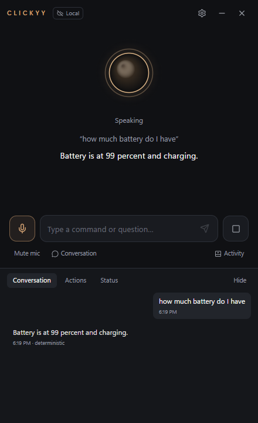
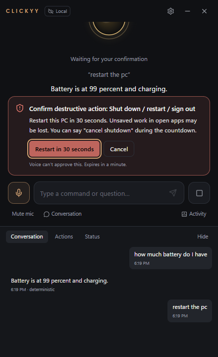
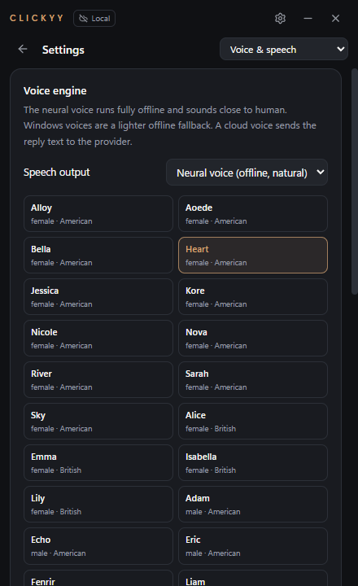

<p align="center">
  
</p>

<p align="center">
  <a href="https://github.com/chinmoyy12/clickyy-ai/releases/latest/download/Clickyy-AI-Setup.exe"></a>
  &nbsp;
  <a href="https://chinmoyy12.github.io/clickyy-ai/"></a>
</p>

<p align="center">
  
  
  
  
</p>

**Clickyy** is a privacy-conscious voice assistant and supervised desktop agent for Windows 11. Just say *“Clicky”*, in English or Hindi. It listens on-device, answers with a natural voice, runs your PC through validated tools, and thinks with **any model you choose**:

| Brain | How |
|---|---|
| **Claude** (Anthropic) | official SDK, streaming, tool calling |
| **Gemini** (Google), **GPT** (OpenAI), **Grok** (xAI), **Mistral**, **DeepSeek** | documented OpenAI-compatible endpoints, streaming, tool calling |
| **Llama, Qwen, Kimi…** on **Groq**, or **300+ models via OpenRouter** | same adapter: pick from the provider's live model list |
| **100% local**: **Ollama**, **LM Studio**, **llama.cpp**, **vLLM** | loopback only, works in Strict Offline mode |

Set a primary provider, a fallback provider and a local fallback. If one fails, Clickyy moves on to the next.

### ⚡ New in 0.6.0: it just does it

- **Songs start playing.** "Play Kesariya" finds the top match and starts it on YouTube Music. You no longer land on a search page.
- **Talk over it.** While Clickyy speaks, just start talking, or say "stop", "wait" or "ruko". It stops and does what you said. Its own voice is filtered out by comparing words, so this works on speakers too.
- **Acts instead of describing.** The AI now follows a written workflow, documented in [docs/ASSISTANT_RULES.md](docs/ASSISTANT_RULES.md): decide, act, chain steps, check, then report in a sentence.
- **Gemini works out of the box.** It uses current Gemini 3.5 models. A key for any provider is used even when another provider is selected, and Gemini 3 multi-step tool calls work.

### 🔍 New in 0.5.1: engineering audit

An independent pass over the whole app against the product blueprint fixed 14 bugs. The full report, with what works, what doesn't and what needs real hardware, is in [docs/AUDIT.md](docs/AUDIT.md).

- Hindi replies are spoken by the Hindi neural voice. Before this fix they were silent.
- Pressing Stop with the cloud voice no longer freezes voice control.
- English sentences are no longer mistaken for Hinglish.
- 15 everyday commands that were missed or misrouted now work: "play Alfaaz", "start a 25-minute focus timer", "turn Bluetooth on", "repeat that more slowly", "add milk to my shopping list".
- Cloud AI calls send only relevant tool definitions. Plain questions used to carry about 13,000 extra tokens and now carry none.
- Smart-home, email and calendar requests get an honest "not connected" answer. The AI model can no longer claim it switched off your lights.
- New "Upcoming" tab to see and cancel reminders and timers, and a "New chat" button.

### 🎙️ New in 0.5: always listening for "Clicky", in English and Hindi

| | |
|---|---|
| 👂 **Always listening for "Clicky"** | On by default, like a smart speaker. It runs on the PC, the "mic on" badge is always shown, and one click mutes it. "Clicky", "Hey Clicky", "Okay Clicky" and "Jarvis" all work. Say it in one breath, "Clicky, set the volume to 30 percent", and it just does it. |
| ✅ **Two-stage wake word** | A cheap always-on spotter, then a second, more accurate recognizer that confirms it really heard "Clicky". In our benchmark it caught 86.5% of wake words (0.4: 45%), with 3.3% of sound-alikes like "quickly", "tricky" and "Vicky" accepted. |
| 🇮🇳 **Hindi and Hinglish** | Speak Hindi, English or a mix. Clickyy detects the language every sentence (multilingual Whisper), writes Hindi in Devanagari, understands Hindi commands ("आवाज़ तीस प्रतिशत कर दो", "स्पॉटिफ़ाई खोलो", "कल सुबह नौ बजे मीटिंग का रिमाइंडर सेट करो"), and answers in Hindi with a Hindi neural voice. "मत करना" (don't) is never treated as a yes. |
| 🎯 **Measured, not guessed** | A synthetic benchmark of 260 English, Hindi and Hinglish commands across 20+ voices (American, British, Indian-accented and Hindi) in clean, noisy, crowd, echoey-room, quiet and far conditions. Keyword accuracy: English 91.3%, Hindi 72.4% (0.4: 44%), Hinglish 61.1%. Details are in [docs/TEST_PLAN.md](docs/TEST_PLAN.md#speech-accuracy-benchmark). |
| 🚀 **Optional best-accuracy model** | Settings › Voice › Best accuracy downloads Whisper large-v3-turbo (1.6 GB, pinned version, SHA-256 checked). It's the most accurate, but slow on laptop CPUs. |

### 🧰 New in 0.4: the 10,000-command update

We checked Clickyy against a list of 10,000 everyday laptop requests in 191 intent families. Every family now routes to the right tool, or on purpose to the language model for open-ended study questions. A sample of 1,081 of those commands runs in the test suite on every build.

| | |
|---|---|
| 📊 **Interactive Excel builder** | "Create an Excel sheet for a monthly budget by asking me questions" → Clickyy asks for each row ("rent, fixed, 15000, 14500"), and you say "done". It writes a real `.xlsx` with formulas and totals. **30 templates**: budget, invoice, EMI and loan schedule (with prepayment), inventory, payroll, gradebook, habit tracker and more. You can also say "use columns" and name your own. |
| 💻 **Code projects** | "Write a Python program for a REST API client", "create a modular TypeScript project with unit tests", "add docstrings to my Java code". Files are saved to Documents\Clickyy\Projects. **Clickyy never runs code**: it tells you the command to run it yourself. Needs a language model. |
| ⚙️ **35 Windows features** | Turn on, turn off, toggle, check or reset Wi-Fi, Bluetooth, dark mode, night light, hotspot, airplane mode, power plans, file extensions and more. Turning Wi-Fi off asks you first. Privacy and security switches only open their Settings page. |
| 🩺 **25-area diagnostics** | CPU and temperature, memory, disks, disk speed, battery health, GPU, bandwidth, IP, Wi-Fi signal, ports, USB, Bluetooth, display, updates, crashes and latency. It can check them against safe limits, sample for 10 seconds, find the app causing a spike, or save the report as text, JSON or Excel. It can also copy it, show it as a notification, pin it to notes or start an email. |
| ⏻ **Power timers** | "Put my laptop to sleep in 30 minutes", "cancel the scheduled shutdown", "turn off the monitor without sleeping". Brightness and microphone level too. |
| 🪟 **App and window control** | Running, memory, version and install folder for any app. Force quit (asks first; system processes are protected), restart, start with Windows, center, resize, keep on top, move to the other monitor, show only one app, screenshot one window, mute one app. |
| 📁 **Files by type** | Find, count, sort, find the largest or the newest PDFs, images, Excel files and more in any folder. Find duplicates (read-only). Organize, date-stamp, zip or back them up. Clickyy never deletes or overwrites a file. |
| 🎵 **Music** | Songs on Spotify or YouTube Music, artist radio and top hits, local MP3 shuffle (writes a playlist), lyrics search, "pause after this song". |
| ✅ **Productivity** | To-dos with priority and backlog, notes (export to PDF or Markdown), checklists read aloud, a time tracker, a stopwatch, repeating, snoozed and rescheduled reminders, and alerts before events ("Friday at 3 pm" works). |
| ✉️ **Drafts, never sends** | "Draft an email to Rahul about the report" and "send a WhatsApp message to Priya…" open a ready draft. You press Send. |
| 🕶️ **Private search** | "Open YouTube in incognito and search for…" opens a private window in Chrome, Edge, Firefox, Brave or Opera. |

### 🚀 New in 0.3 — 1,450+ things by name, and it thinks before it opens

| | |
|---|---|
| 🌐 **Knows websites from apps** | "Open YT Music" → *"YouTube Music is a website. Should I open it in Chrome or Edge?"* Answer "Chrome", or "always Chrome" and it remembers. Or say "open YT Music in Edge". **760 websites and web apps** by name, from Gmail and Notion to IRCTC and Zerodha. |
| 🔎 **Search inside sites** | "Play lofi on YouTube", "search Amazon for earbuds", "look up black holes on Wikipedia": **68 sites**. |
| 🗂️ **Every app you have** | Reads your Start menu at launch, so any installed app opens by name ("open Obsidian", "open Notepad++"). |
| ⚙️ **All of Windows** | **118 Settings pages** ("open dark mode settings", "Windows Update"), **52 Windows tools** (Device Manager, Event Viewer, Disk Cleanup, environment variables…) and **31 special folders** (Recycle Bin, Screenshots, AppData…). |
| 🎙️ **Always-listening switch** | One click on the main screen (or say "turn on always listening") and just say "Jarvis" any time. |
| 🩺 **Self-test** | "Run a self test" (or the button in Activity → Status) checks understanding of all 253 example commands, the Windows bridge, the speech engine, a real reply from the language model, tools, network and storage. |
| 🌍 **Quick knowledge** | World clock for **307 places**, currency in **28 currencies** (ECB rates), "how many days until Christmas", coin flips, dice and random numbers. |
| 🤔 **Asks instead of failing** | An unknown name gets "I couldn't find that. Should I search the web for it?" |
| 🦙 **Ollama starts itself** | No need to keep Ollama running; Clickyy starts it and uses any installed model. |

Say **"what can you do"** and Clickyy tells you its real count, measured from its own catalogs.

### ✨ New in 0.2 — the "Jarvis" update

| | |
|---|---|
| 🗣️ **Neural voice, offline** | Kokoro-82M runs on your CPU with 28 English voices: warm American (Heart, Bella, Nova) and British (Emma, Isabella, Lily). It speaks sentence by sentence as the next one is prepared, and the orb pulses with the real voice. |
| 🎧 **Near-perfect understanding** | Whisper re-reads each command after you finish speaking (about 0.6 s), on top of Vosk's instant live captions. Misheard app names ("spotfy", "crome") are fuzzy-matched. |
| ✋ **Interrupt by talking** | Optional barge-in: start speaking while Clickyy talks and it stops to listen (echo-cancelled). |
| 🌅 **Morning briefing** | "Brief me": time, weather, battery and today's reminders in one reply. |
| 🩺 **System report** | "How's my computer doing?": CPU, memory, battery, disk and network, with a warning when something's off. |
| 🌦️ **Weather** | "Do I need an umbrella?" via Open-Meteo. Free, no account. |
| 🧮 **Calculator & conversions** | "What's 15 percent of 240?", "convert 5 miles to km". Offline, with a real parser (no `eval`). |
| 👁️ **Screen vision** | "What's on my screen?": one screenshot, only after you confirm, sent to a vision model (Gemini, Claude, GPT). Never stored. |
| 📋 **Clipboard AI** | "Summarize / translate / proofread what I copied". |
| 🔔 **Proactive alerts** | Speaks up when the battery runs low or the CPU stays pegged. |
| 🎩 **Butler persona** | Composed, impeccably polite, dry wit. One of ten personalities. |
| 🧠 **Better local AI** | Small local models get only the relevant tools, fall back from GPU to CPU automatically when a GPU driver faults, and stay warm, so llama3.2 answers in about 1.2 s. |

### ⬇️ Install

1. **[Download Clickyy-AI-Setup.exe](https://github.com/chinmoyy12/clickyy-ai/releases/latest/download/Clickyy-AI-Setup.exe)** (~440 MB, Windows 11 x64, no admin needed). Offline speech recognition and the neural voice are included.
2. Run it. This build isn't code-signed yet, so if SmartScreen appears, click **More info → Run anyway**.
3. Press **Ctrl+Shift+Space** anytime to show Clickyy. For conversation, install [Ollama](https://ollama.com) and run `ollama pull llama3.2`, or add a cloud key in Settings → Credentials. You don't need to keep Ollama running: Clickyy starts it when needed, and uses any installed model if the configured one is missing.

<p align="center">
  
  
  
</p>

## What works today (verified on real hardware)

| Area | Verified how |
|---|---|
| Desktop app launches, packaged and installed | `npm run e2e` against the dev build and the NSIS-installed v0.4.0 app: **61/61 checks**, including live Windows feature status, a diagnostic report, app status, files by type, to-dos and a real `.xlsx` from the Excel builder |
| **Live local AI** | `node scripts/live-test.mjs local` against the installed app with a real **llama3.2** on Ollama: streamed answer (about 1.2 s), contextual follow-up, a real tool call that changed the volume, and a model-proposed restart stopped at the confirmation. **6/6** |
| Neural voice + Whisper | Kokoro synthesizes through the app's IPC (about 1–1.7 s per sentence on this CPU); Whisper refines recorded speech to "set the volume to thirty percent"; a round-trip test has Kokoro speak and Whisper understand it |
| Offline speech recognition (Vosk) | Real Vosk engine transcribes recorded speech through the full app path (renderer IPC → main → Python service): final transcript "open notepad" |
| Wake phrases "Hey Clickyy", "Clickyy", "Jarvis" | Detected by the real engine on recorded speech in pytest; "Jarvis" also detected end to end in the running app |
| Offline speech output | Windows voices Zira, David and Mark are available to the app, and an utterance played to completion |
| Microphone capture | Real Realtek microphone array opened and measured from the app (peak level reported) |
| Windows control | Real volume read, set and restore via Core Audio; battery, CPU, RAM, disk, Wi-Fi, audio devices, window list, media session, app launch with window verification |
| Safety | Shell requests refused; power actions blocked until permitted; destructive actions require on-screen confirmation and decline cleanly; unknown names are never launched (Clickyy offers a web search instead) |
| Strict Offline | Remote hosts are blocked at the network layer (unit-tested); with no local model the app says so honestly |
| Bundled offline voice | The installed app runs the frozen speech engine (no Python needed): recognition and the "Jarvis" wake phrase pass end to end |
| Automated tests | **1,732 TypeScript tests** (Vitest, including 1,081 sampled commands from the 10,000-command list) + **25 Python tests** (pytest, real Vosk, Whisper and Kokoro engines), typecheck, security lint — all passing |

Not yet verified: a live cloud call (pending an API key; every cloud adapter is tested against mocked HTTP and SDK transports, and `node scripts/live-test.mjs cloud --provider gemini` runs the same 6 live checks once a key is saved), and a spoken command from a person into the live microphone. See [docs/TEST_PLAN.md](docs/TEST_PLAN.md) for the manual checklist.

## Quick start (development)

```bash
cd apps/desktop
npm install
npm run build
npm start
```

Optional offline voice input (Python 3.10+, downloads ~40 MB):

```bash
powershell -ExecutionPolicy Bypass -File scripts/setup-speech.ps1
```

Run every check:

```bash
cd apps/desktop
npm run check
npm run e2e
```

Build the Windows installer (`apps/desktop/release/Clickyy-AI-Setup-0.1.0.exe`):

```bash
cd apps/desktop
npm run dist
```

Full setup, troubleshooting, Smart App Control notes and installed-app speech setup: [docs/SETUP.md](docs/SETUP.md).

## Using Clickyy

- **Type** in the box or press the **mic** button (push to talk). Switch to **Wake word** or **Conversation** mode in Settings → Listening.
- **Esc** stops everything. **Ctrl+Shift+Space** shows or hides the window. **Ctrl+Shift+M** mutes the microphone. The tray icon has **Emergency stop** and **Quit**.
- Try: "set volume to thirty percent", "open spotify and put it on the left", "start a 25 minute focus session", "remind me to stretch in 20 minutes", "what's using my memory", "remember that my project is called Atlas", "switch to work mode".
- Create **routines** in Settings → Routines, e.g. "coding mode" → open VS Code, open workspace, volume 20%, focus timer.
- To enable open-ended conversation, either install [Ollama](https://ollama.com) or [LM Studio](https://lmstudio.ai) and load a model, or add a key for Anthropic, Google Gemini, OpenAI, Groq, OpenRouter, Mistral, DeepSeek or xAI in Settings → Credentials. Then allow cloud use in Settings → AI & routing and click **Load models** to pick from the provider's live list.

## Documentation

| Document | Contents |
|---|---|
| [docs/ARCHITECTURE.md](docs/ARCHITECTURE.md) | Process model, module boundaries, dependency decisions, data flow |
| [docs/SECURITY.md](docs/SECURITY.md) | Threat model, privacy model, tool risk levels, what is stored where |
| [docs/CAPABILITIES.md](docs/CAPABILITIES.md) | Offline vs online capability matrix, voice provider compatibility matrix |
| [docs/COMMANDS.md](docs/COMMANDS.md) | Generated command catalog and tool registry |
| [docs/SETUP.md](docs/SETUP.md) | Setup, model downloads, API keys, troubleshooting |
| [docs/TEST_PLAN.md](docs/TEST_PLAN.md) | Automated test coverage, measured results, manual acceptance checklist |
| [docs/WAKE_WORDS.md](docs/WAKE_WORDS.md) | How wake phrases work, accuracy notes, tuning |
| [docs/SPEECH_PROTOCOL.md](docs/SPEECH_PROTOCOL.md) | Loopback protocol between the app and the speech service |
| [docs/PACKAGING.md](docs/PACKAGING.md) | Installer build, code signing, distribution |
| [docs/DEPENDENCIES.md](docs/DEPENDENCIES.md) | External downloads, API keys, licenses, optional integrations |

## Repository layout

```
apps/desktop/            Electron + React + TypeScript app
  src/main/              main process: assistant core, tools, providers, storage, security, Windows bridge client
  src/preload/           minimal contextBridge API
  src/renderer/          UI, mic capture, TTS playback, voice interaction controller
  src/shared/            settings schema, IPC contract, shared types, voice profiles
  resources/windows/     bridge.ps1 (fixed allowlist of Windows operations)
  tests/                 Vitest suites
  scripts/               build, dev, e2e, security lint, docs generator
services/assistant/      Python speech service (FastAPI + Vosk), pytest suite
scripts/                 setup-speech.ps1, build-speech.ps1 (freeze for installer), make-speech-fixtures.ps1, make-icon.ps1
site/                    3D animated landing page (three.js), published to GitHub Pages
assets/                  animated README banner
docs/
```

To build the installer with offline voice bundled:

```bash
powershell -ExecutionPolicy Bypass -File scripts/setup-speech.ps1
```

```bash
powershell -ExecutionPolicy Bypass -File scripts/build-speech.ps1
```

```bash
cd apps/desktop && npm run dist
```

## Known limitations

These are honest gaps, not hidden ones.

1. **Cloud providers haven't been called live yet.** The Anthropic adapter and the OpenAI-compatible presets (Gemini, OpenAI, Groq, OpenRouter, Mistral, DeepSeek, xAI) are tested against mocked transports. The local path *is* verified live with llama3.2. Default model names are starting points; use **Load models** to pick a current one.
2. **Small local models are less capable than cloud ones.** llama3.2 (3B) handles questions and single actions well. Multi-step agent tasks work better with a cloud model or a larger local one.
3. **"Clicky" is not perfect, and no wake word is.** On our synthetic benchmark the two-stage wake word catches 86.5% of wake words and accepts 3.3% of sound-alikes, about 6 false wakes per hour of nearby conversation. Real voices and rooms will differ. "Jarvis" and "Hey Clicky" are the most reliable. A trained keyword model on real recordings is the next step ([docs/WAKE_WORDS.md](docs/WAKE_WORDS.md)).
4. **The neural voice is CPU-bound.** About 1–1.7 s to the first sentence on an i5-11400H; slower PCs can switch to the Windows voice. Profiles adjust wording plus speed (and pitch on Windows voices); Kokoro has no emotion tags.
5. **Barge-in by talking needs reasonable echo cancellation.** Headphones are best. On loud speakers Clickyy may hear itself, so it's off by default.
6. **Not implemented:** calendar and email (needs OAuth integrations), document search over your files (RAG), workspace layout save/restore, process termination, cost tracking, macOS and Linux.
7. **Spotify playlists:** Clickyy opens Spotify search for the playlist; it can't press play on a specific playlist without the Spotify Web API (not integrated).
8. **English and Hindi only, and Hindi is harder.** Whisper small catches 72% of Hindi keywords and 61% of Hinglish keywords on our benchmark, against 91% for English, and far, noisy Hindi is weak. The optional large-v3-turbo download raises Hindi to about 87% and Hinglish to about 94%, at about 8 s per sentence. In English + Hindi mode a sentence takes about 2–3 s to transcribe; English only takes about 1 s. Live captions while you speak are still English-only (Vosk); the final Hindi transcript replaces them.
9. **Code signing is pending SignPath approval.** The release workflow signs every executable and the installer automatically once the SignPath secrets are added ([docs/SIGNING.md](docs/SIGNING.md)). Until then, Windows SmartScreen warns on first run, and PCs with Smart App Control enabled block the app.
